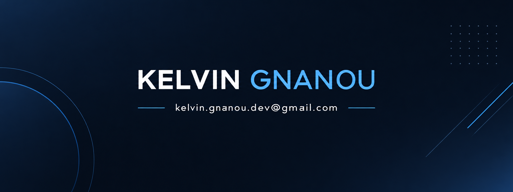

  

# GNANOU KELVIN

**Computer Engineering | AI & Data**

From algorithms and systems to intelligent solutions.

---

## Professional Profile

Computer Engineering student 
interested in understanding complex systems and developing efficient computational solutions, 
with a focus on Artificial Intelligence and Data Science.

---

## Technical Skills

### Programming Languages

### Web Development

### Databases

### Development Tools & Environment

### Computer Science Fundamentals

Data Structures · Algorithms · Complexity Analysis · Object-Oriented Programming · Memory Management

---

## Education

**Mohammadia School of Engineers (EMI)**
Computer Engineering | 2026 – Present

**Faculty of Sciences and Technology of Fez (FST)**
DEUST – Mathematics and Computer Science | 2024 – 2026

---

## Projects

### [Personal Portfolio](https://kelvin-gnanou.github.io)

Personal portfolio showcasing projects, technical skills, and professional work.

**Technologies:** HTML5 · CSS3 · JavaScript

---

## Areas of Interest

Artificial Intelligence · Machine Learning · Data Science · Algorithms · Optimization · Computational Methods

---

## Connect

[GitHub](https://github.com/kelvin-gnanou) · [LinkedIn](https://www.linkedin.com/in/kelvin-gnanou-a1755b40b/) · [Portfolio](https://kelvin-gnanou.github.io/) · [Email](mailto:kelvin.gnanou.dev@gmail.com)
